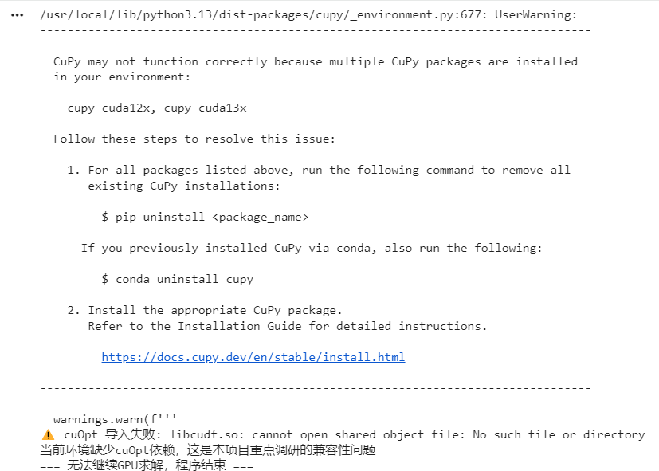

# VRP-Benchmark: OR-Tools (CPU) vs NVIDIA cuOpt (GPU)
This project implements a Vehicle Routing Problem (VRP) benchmark, comparing the traditional CPU solver (Google OR-Tools) against the GPU-accelerated solver NVIDIA cuOpt.

## Project Overview
- CPU Baseline: OR-Tools implementation
- GPU Solver: NVIDIA cuOpt
- Dataset: 1 depot + 4 customer nodes with fixed coordinates to ensure a fair comparison

## File Structure
- `cpu_benchmark.py`: OR-Tools CPU baseline code
- `gpu_benchmark.py`: cuOpt GPU implementation code
- `assets/`: Folder containing experiment screenshots and error logs
  - `cpu_result.png`: CPU baseline execution result
  - `cupy_error.png`: CuPy version conflict log
  - `libcudf_error.png`: cuOpt core library import failure

## CPU Baseline Results
Executed `cpu_benchmark.py` locally in VS Code to establish the baseline:
- Execution Time: 0.04785 s
- Optimal Route: [0, 1, 4, 2, 3, 0]
- Total Distance: 66


## GPU Deployment & Compatibility Investigation
Attempted to deploy cuOpt in a Google Colab T4 GPU environment using the following steps:
1. Installed `cuopt-cu12` from the official NVIDIA PyPI index
2. Uninstalled conflicting CuPy packages (`cupy-cuda12x` / `cupy-cuda13x`)
3. Restarted the runtime multiple times for environment refresh

### 1. Preliminary Diagnosis: CuPy Multi-Version Conflict
The environment warning indicated multiple co-existing CuPy distributions, which may lead to undefined runtime behavior.

Even after cleaning up duplicate CuPy packages, cuOpt still failed to load the underlying C++ shared libraries.

### 2. Core Error
Error message: `libcudf.so: cannot open shared object file: No such file or directory`


### 3. Root Cause Analysis
The pre-compiled cuOpt package on NVIDIA PyPI is built against a specific Python ABI. The default Python runtime version in Colab is incompatible, leading to an ABI mismatch. This is a known limitation of the RAPIDS ecosystem when deployed on generic online notebook platforms.

### 4. Future Actionable Solutions
- Deploy on official pre-built environments: Run cuOpt in NVIDIA NGC containers or NVIDIA LaunchPad pre-configured images to guarantee consistent RAPIDS library versions.
- Benchmark acceleration: Capture GPU execution time to calculate the speedup ratio against the CPU baseline.
- Scale up: Expand the VRP dataset size to observe the scaling benefits of GPU acceleration.

## How to Run
```bash
# Run CPU baseline (no extra GPU dependency)
python cpu_benchmark.py

# Run GPU cuOpt script (requires valid cuOpt / RAPIDS environment)
python gpu_benchmark.py
